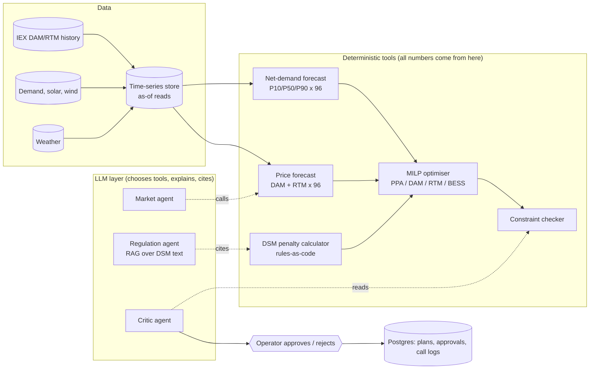

# BlockWise

> Block-wise power procurement copilot for Indian DISCOMs.

**Status:** skeleton. Nothing is implemented yet; see [ROADMAP.md](ROADMAP.md).

| | |
|---|---|
| Live demo | _TODO: link (Phase 11)_ |
| 2-minute video | _TODO: link (Phase 11)_ |
| Failure post | _TODO: link to the post in `posts/` (Phase 11)_ |

## What it does

_TODO (2-3 sentences, your words)._ A DISCOM buys power for 96 fifteen-minute blocks a day across long-term PPAs, the day-ahead market (DAM), the real-time market (RTM) and battery storage (BESS). It overpays at peak prices and pays deviation (DSM) penalties when actual demand misses the schedule. BlockWise forecasts net demand and prices, computes penalties, optimises the purchase split, and has an agent explain the schedule for an operator to approve.

**Design rule:** the LLM never does arithmetic. It chooses which tools to call and explains their results; deterministic code produces every number. See [ADR-0001](docs/decisions/0001-llm-never-does-arithmetic.md).

## Architecture



_TODO: replace with your own diagram once the design settles; keep it truthful to what is built._

## Evaluation

All rows start empty and are filled by `evals/run_evals.py` and the backtest. Numbers here must come from a reproducible run.

| Component | Metric | Baseline | BlockWise | Notes |
|---|---|---|---|---|
| Net-demand forecast (day-ahead) | MAPE / pinball loss | _TODO_ | _TODO_ | |
| DAM price forecast | MAE (₹/MWh) | _TODO_ | _TODO_ | |
| RTM price forecast | MAE (₹/MWh) | _TODO_ | _TODO_ | |
| Regulation RAG | context recall / faithfulness | _TODO_ | _TODO_ | RAGAS |
| Regulation RAG | citation accuracy | - | _TODO_ | clause cited actually supports the answer |
| Critic | injected-violation detection rate | - | _TODO_ | |
| Agent | tool-routing accuracy | - | _TODO_ | adversarial prompts |
| Agent | ungrounded numbers per explanation | - | _TODO_ | target 0 |
| Cost / latency | ₹ and seconds per plan run | - | _TODO_ | |

### Backtest (₹)

| Period | Baseline cost (₹) | BlockWise cost (₹) | Savings (₹) | Savings (%) | Oracle gap captured |
|---|---|---|---|---|---|
| _TODO_ | _TODO_ | _TODO_ | _TODO_ | _TODO_ | _TODO_ |

## Key decisions and why

See [docs/decisions/](docs/decisions/README.md). _TODO: summarise the five that matter most, in your words._

## What broke and how I fixed it

_TODO: the one failure that taught you the most; also published as a post in `posts/`._

## What I'd change at scale

_TODO: see [docs/system-design.md](docs/system-design.md)._

## Local development

```bash
uv sync --extra dev
uv run pytest
uv run ruff check . && uv run ruff format --check .
```

Full stack (Phase 4 onward): `cp .env.example .env`, edit it, then `docker compose up`.

## Testing

`tests/unit` (pure logic), `tests/agents` (scripted fake LLM; never a paid call), `tests/integration` (FastAPI TestClient). LLM-graded evals are separate (`evals/`).

## Deployment, environments and rollback

See [docs/runbook.md](docs/runbook.md). Required variables: [.env.example](.env.example).

## Docs

[architecture](docs/architecture.md) · [system design](docs/system-design.md) · [domain primer](docs/domain-primer.md) · [assumptions](docs/assumptions.md) · [concept map](docs/concept-map.md) · [interview prep](docs/interview-prep.md) · [video script](docs/demo-video-script.md)
